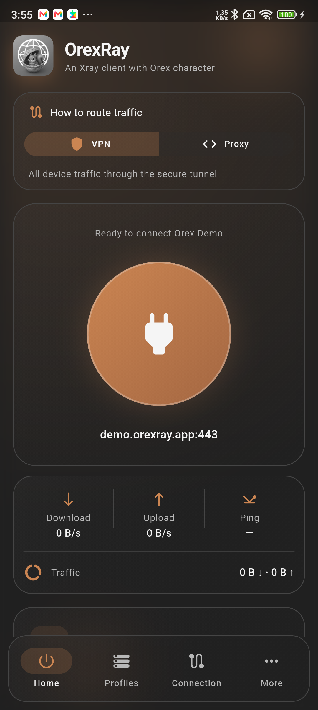
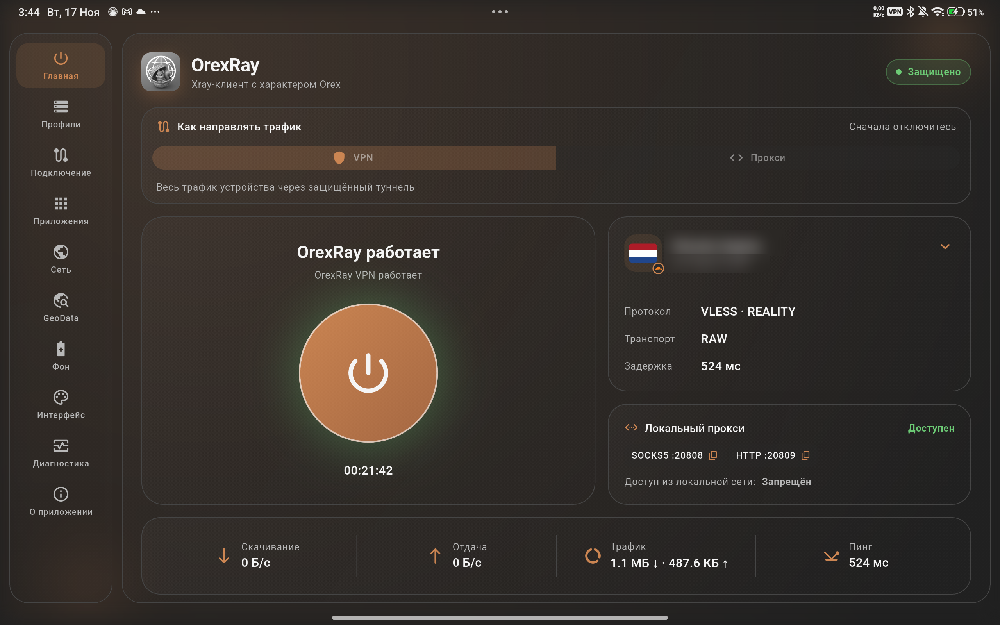

# OrexRay

[](https://github.com/Vasysik/orex-ray/releases)
[](LICENSE)

A friendly **Xray client** for **Android** and **Windows**, built with Flutter.
System VPN, system proxy, local SOCKS5/HTTP proxies, VLESS / VMess / Trojan /
Shadowsocks / SOCKS / HTTP profiles, balancers and per-app routing — in one
warm, glassy interface with a squirrel.

**English** · [Русский](README.ru.md) · [Changelog](CHANGELOG.md)

<p>
  
  
  
</p>
<p>
  
</p>

## Why OrexRay

- **One-tap VPN** — Android `VpnService` with real TCP/UDP through Xray,
  running in the background as a foreground service, with a Quick Settings
  tile that works even when the app is closed.
- **Every connection mode** — full TUN VPN, Windows system proxy, and local
  SOCKS5 (`127.0.0.1:20808`) / HTTP (`127.0.0.1:20809`) proxies for manual
  app configuration.
- **Full Xray profiles** — VLESS/REALITY, VMess, Trojan, Shadowsocks, SOCKS
  and HTTP without artificial simplification. Import links, subscriptions,
  QR codes, raw JSON or full configs.
- **Balancers** — pick the lowest-ping server automatically, round-robin, or
  random per connection. Groups of servers stay dynamic.
- **Split tunneling** — choose which apps use the VPN and which bypass it
  (Android).
- **Subscriptions** — HTTP/HTTPS subscription auto-updates, quota and expiry
  tracking, HEAD-based metadata refresh.
- **Themes** — a neutral gray theme out of the box, several built-in presets,
  and a full theme editor: colors, glass panels, mascots, JSON export/import.
- **Two languages** — Russian and English, following the system by default.

## Install

### Android

Download the latest APK for your device (`arm64-v8a` fits most modern phones)
from [GitHub Releases](https://github.com/Vasysik/orex-ray/releases) and
install it. OrexRay can update itself in-app via GitHub Releases.

### Windows

Download the installer (`OrexRay-<version>-x64-setup.exe`) from
[GitHub Releases](https://github.com/Vasysik/orex-ray/releases). TUN/VPN mode
requires administrator rights; system proxy and local proxy modes work
without them.

## Quick start

1. Open **Profiles** and import a link (`vless://`, `vmess://`, `trojan://`,
   `ss://`, `socks5://`, `http(s)://`), a subscription URL, a QR code, or Xray
   JSON.
2. Back on **Home**, tap the big round button.
3. Optional: tune routing in **Connection**, split tunneling in **Apps**, and
   themes in **Interface**.

## Documentation

- [Release builds](docs/release-builds.md) · [Android release](docs/release-android.md) · [Windows release](docs/release-windows.md)
- [In-app updates via GitHub Releases](docs/github-app-updates.md)
- [Android debugging / ADB](docs/android-debugging.md)

## Build from source

```bash
flutter pub get
flutter build apk --release        # Android
flutter build windows --release    # Windows
```

The version is set only in `pubspec.yaml` (`version:` field).

## License

OrexRay is distributed under the [MIT](LICENSE) license: the source code can
be used, modified and distributed, including commercially, as long as the
copyright notice and the license text are preserved. The software is provided
"as is", without warranties. See also [THIRD_PARTY_NOTICES.md](THIRD_PARTY_NOTICES.md).

<details>
<summary><b>Full documentation</b> — product focus, connection modes, reliability, profiles, themes, balancers, security, architecture</summary>

## 1. Product focus

OrexRay is not built as "one big TUN button". The connection mode is a
separate part of the product, because different apps and platforms need
different routing approaches.

Core principles:

- a single Flutter codebase for Android and Windows;
- native Android `VpnService` for a full system VPN;
- system proxy as the primary soft mode on Windows;
- local SOCKS5 and HTTP proxies for manual app configuration;
- VLESS/REALITY and other Xray profile parameters without artificial
  simplification;
- honest separation of UI, profiles, Xray config and platform engines;
- Orex UX: the original warm theme with glass panels, copper accents and the
  squirrel, plus built-in and user-defined themes.

## 2. Connection modes

### Android

Two user-facing modes are supported:

- **VPN** — all selected traffic goes through the Android `VpnService` and
  TUN;
- **Local proxy** — Xray exposes SOCKS5/HTTP without a system VPN.

In VPN mode OrexRay also brings up the local proxies by default. This is
useful, for example, when an app is excluded from the TUN but is manually
configured to use the local SOCKS5.

The **OrexRay VPN** tile in Android Quick Settings keeps its state outside
the Flutter process. After the interface is closed it can both stop the VPN
and start the last successful VPN connection again without opening the app.

```text
Android apps
    │
    ├── VpnService / TUN ──────────┐
    │                              │
    ├── SOCKS5 127.0.0.1:20808 ───┤
    └── HTTP   127.0.0.1:20809 ───┤
                                   ▼
                               Xray Core
                                   │
                              VLESS / TLS /
                                 REALITY
```

### Windows

Three modes are supported:

- **System proxy** — OrexRay raises a local HTTP proxy and points the Windows
  settings at it;
- **VPN / TUN** — the mode for full traffic capture;
- **Local proxy** — SOCKS5/HTTP without changing system settings.

The system proxy stays the lightest Windows mode: it does not need TUN for
apps that know how to use the system proxy settings.

On Windows OrexRay runs as a single instance. The close button hides the
window to the system tray by default; this behavior can be disabled on the
**Background** screen. The same screen offers starting with Windows and a
separate automatic connection of the selected profile. Autostart launches
hidden into the tray.

The tray **Exit** command first stops the tunnel and restores the system
proxy, and only then quits the application. The running Xray is bound to the
OrexRay process at the Windows level, so it does not stay orphaned after a
client crash.

Before every start, Windows TUN detects the active physical interface and
explicitly binds the Xray outbound to it. OrexRay ignores notifications from
its own `OrexRay` interface and does not rebuild the connection when Windows
reports a network change but the physical outbound actually stayed the same.
After a real Wi‑Fi/Ethernet/hotspot change the TUN is rebuilt with the new
interface.

Windows TUN relies on Xray Core 26.4.13 capabilities for gateway, DNS, the
system route table and explicit outbound binding to the physical interface.
The Windows best-route diagnostic stays an advisory signal: it does not stop
an already working TUN just because `GetBestInterface` returned the name of
the physical adapter. The real acceptance test for TUN is a changed external
IP and passing IPv4/IPv6 traffic.

## Long-running connection reliability

The current branch has an improved recovery contour for the "forgot the VPN
exists" scenario:

- Windows receives resume and IP-interface change events from the OS;
- events of the own `OrexRay` interface are filtered natively;
- noisy notifications that did not change the physical outbound do not
  restart Xray;
- the active TUN is rebuilt with a new outbound binding after a real physical
  network change;
- if the network changes again right during recovery, the event is not lost
  and is re-evaluated after a short cooldown;
- the best public IPv4/IPv6 route is diagnosed, but the advisory check does
  not kill a working TUN;
- the Xray watchdog classifies unexpected exits and does not restart on fatal
  configuration errors, occupied ports and Access Denied;
- safe crash/transient exits are restarted with backoff;
- the watchdog budget is 3 automatic restarts per 60 seconds;
- before every Windows start only orphan processes with the exact path to the
  managed `xray.exe` are removed;
- the system proxy is restored after stop/crash and does not overwrite
  someone else's change;
- the Android foreground service stays `START_STICKY`, and a separate
  core watchdog raises Xray after an unexpected stop;
- optional auto-connect on Android can restore the last successful VPN after
  a reboot if the VPN permission was already granted.

For the strictest always-on scenario it is still better to additionally
enable the Android system **Always-on VPN** feature: its lifecycle is managed
by the OS itself.

## Diagnostics

The **Diagnostics** screen shows:

- OrexRay and Xray versions;
- mode, profile and runtime state;
- PID and local ports;
- the Windows system proxy state;
- the physical outbound interface and an advisory snapshot of the best
  IPv4/IPv6 route for Windows TUN;
- the watchdog/restart budget, last error and exit code;
- up to 100 lines of the merged `[OrexRay]` + `[Xray]` log.

The Xray log level setting lives on the same screen. At `debug` level, noisy
Xray lines are evicted earlier than OrexRay's own records, so recovery and
watchdog decisions stay visible in the report.

The **Copy report** button additionally redacts UUIDs, `vless://` links and
typical secret fields. The report is meant for bug reports without publishing
the access configuration.

On Windows, engine maintenance lives in **About → Engine**. The
**Reinstall Xray Core** button only works while the tunnel is disconnected,
restores the pinned Core version and verifies the archive against the
built-in SHA-256. Installation into Program Files requires administrator
rights; portable/debug builds are repaired in their own directory without
reinstalling the whole OrexRay.

## Exit flags and WARP

After a successful connection OrexRay can verify the exit through the local
HTTP proxy of Xray itself. From the Cloudflare trace response only the
country code, the WARP flag and the check time are stored — the exit IP is
not stored. The profile card shows the exit country flag, and WARP is marked
with a compact branded Cloudflare badge.

## 3. Profiles and Xray import

Profiles can be:

- imported from proxy links and Xray JSON;
- imported one by one via QR code: camera scanning on Android, QR recognition
  from PNG/JPEG on Windows;
- exported individually as a share link (VLESS, VMess, Trojan, Shadowsocks,
  SOCKS5, HTTP(S)) — in addition to the existing Xray JSON export;
- added as standard HTTP(S) subscriptions, updated manually and
  automatically;
- read from a subscription as a raw list of
  `vless://`/`vmess://`/`trojan://`/`ss://`, a legacy Base64 list or Xray
  JSON;
- read subscription metadata `profile-title`, `subscription-userinfo`,
  `profile-update-interval`, `support-url`, `profile-web-page-url` and
  `announce` from HTTP headers, `#`- or `//`-lines of the body; string
  metadata is understood both in plain text and in `base64:` UTF-8, and body
  values take priority over same-named HTTP headers;
- imported as a JSON object `{...}` or array `[...]`;
- read from a local `.json` file and an HTTP(S) link;
- exported as a single JSON object or selected profiles as an array;
- copied to the clipboard directly without an intermediate file;
- created and edited manually;
- multi-selected with a long press for mass ping/export/delete;
- mass selection of servers and subscriptions is kept separate: "Select all"
  applies only to the current section;
- grouped into custom user groups;
- each subscription expands right in the "Subscriptions" section as a group
  with its servers — without a duplicate folder in "Servers";
- reordered with drag-and-drop inside the current manual group;
- a group is selected with a long press together with all its content, and
  can then be dragged as a single block;
- a manual group can be dissolved without deleting its profiles; to delete a
  whole group with content just select it and use the regular mass delete;
- quick route selection from the home page via collapsible groups: the group
  of the current profile expands immediately, and if there are only plain
  ungrouped servers, the quick picker stays flat without an extra "Servers"
  row;
- the active route can be changed both from home and right from the profile
  list; the selection is displayed immediately, and stop/start runs
  sequentially without blocking the UI.

If several profiles have identical names, the list shows an additional short
label with their ID so the servers are not confused. Identical names are not
forbidden and do not affect profile uniqueness.

A subscription is stored as a separate source: its URL does not turn into an
HTTP proxy. On update OrexRay replaces only the servers of that subscription,
keeping manually added profiles. Deleting a subscription deletes only the
servers that belong to it. On Android, subscription URLs are saved through
the same protected storage channel as profiles. The subscription card shows
the standard `subscription-userinfo` as used/total/remaining traffic and the
expiry date, and `support-url` and `profile-web-page-url` as the "Support"
and "Account" actions. Between full updates OrexRay does not download the
whole server list just for the quota: on launch and on returning to the
foreground a lightweight HTTP HEAD is performed when needed. The metadata
check interval is configured separately from the server update interval and
can be disabled completely. If the provider does not support HEAD, the
metadata simply refreshes on the next regular GET. An error of such a check
does not affect working profiles.

Server auto-update does not keep a permanent background timer: on launch and
on returning to the foreground only the age of the last successful update is
checked. The user sets the minimum interval in "Background", and if the
provider sent `profile-update-interval`, OrexRay does not update the
subscription more often than that recommendation. A failed automatic attempt
does not destroy the old servers and does not block the app launch. On the
first request OrexRay uses its own User-Agent; if the panel returned an
unsupported answer, the request is retried once with a compatibility
User-Agent, because some panels pick the subscription format by User-Agent.

Service subscription nodes that point to loopback (`localhost`,
`127.0.0.0/8`, `::1`) do not enter the server list: their names are kept as
raw/legacy informational provider strings and are shown in the subscription
card through a `·` separator. OrexRay does not try to extract a numeric quota
from arbitrary remarks like "80/80GB": a full traffic bar and expiry are only
built from the standard `subscription-userinfo`. The "Support" and "Account"
buttons are created only from explicit `support-url` and
`profile-web-page-url`; OrexRay does not guess links by node names or
remarks.

Vendor-specific encrypted links (`happ://crypto...`) and provider
subscriptions requiring a special `X-HWID` or non-standard client
identification are not yet considered supported standard subscriptions.

The editor supports the main parameters already used by the current Xray
config builder:

- address, port and UUID;
- flow;
- security: `none`, `tls`, `reality`;
- transport: RAW/TCP, WebSocket, gRPC, XHTTP, HTTPUpgrade;
- SNI, fingerprint, ALPN;
- REALITY public key/password and short ID;
- path, host and gRPC service name;

Adding a new profile **does not switch the active route automatically**. On
the very first profile it becomes selected, because no other route exists
yet.

## Appearance and custom themes

The "Interface" section offers the original Orex and four built-in presets:
**Oreshka Gray**, **Soft Lime**, **Hardcore Red** and **Hacker Green**. The
presets use their own palettes and mascots. The gray theme combines a
graphite background, copper accents and translucent panels.

The theme editor allows changing interface colors, the mascot, transparency,
blur strength and glass glow; changes are visible while editing. You can
create your own themes, copy built-in presets without changing the original,
save your variants and import/export portable JSON files with an image.
Connection state colors in the interface and the Windows tray follow the
current palette.

On Android, some of the home glass panels use background blur optimization.
The glass effect itself remains rasterization-heavy on some devices; it can
be disabled in the appearance settings.

## 4. Quick route switching

The name of the active route on home opens the Orex choice sheet — the same
visual model as the quick audio device picker in Orex Messenger.

Switching profiles is allowed during an active connection. OrexRay performs
a controlled reconnect:

```text
active profile A
        ↓
profile B selected
        ↓
stopping the current core
        ↓
saving B as active
        ↓
starting in the same mode
        ↓
active profile B
```

The connection mode is preserved: VPN stays VPN, local proxy stays local
proxy.

## 5. Balancers

A balancer is created right in OrexRay and used like a regular route. A
single server is enough: this is useful as a draft, for fallback scenarios
and for dynamic folders. You can pick individual servers, whole custom
groups and subscription groups, and mix both ways. The picker works like the
quick switcher on home: groups expand and their servers and individual
checkboxes are visible inside.

A folder in a balancer remains a **dynamic source**: if a profile is added to
it later or a subscription updates the server set, the balancer composition
changes automatically. The resolved set of outbounds is passed into the Xray
config; OrexRay does not create a separate artificial tag hierarchy.

Strategies:

- Random;
- Round Robin;
- Least Ping.

The Xray Observatory uses the shared URL from "Network → Latency check". The
balancer itself keeps only the observation interval; a separate probe URL is
no longer configured there.

Fallback is supported:

- no fallback;
- `direct`;
- `block`;
- a separate VLESS profile.

The fallback profile is not included in the balancer's main selector. It gets
its own outbound and is used only as a backup route.

## 6. Ping and statistics

Ping can be refreshed:

- for all profiles on the profiles page;
- for a single profile;
- by tapping the ping indicator on home.

The current check measures TCP latency to the server address and port. It is
a quick availability indicator, not a full VLESS/REALITY handshake.

While connected the UI shows:

- current download speed;
- current upload speed;
- ping of the active route;
- total incoming and outgoing traffic;
- connection duration.

Intervals are separated: the UI statistics frequency and the Android
notification refresh frequency are configured independently, and ping has its
own interval. On Windows this interval controls the periodic end-to-end check
of the active route; on Android it is performed by the foreground VPN
service. If the UI is closed and the corresponding notification indicator is
off, its periodic task stops completely.

The Android foreground notification shows the profile, speeds and latency in
a compact form, for example:

```text
↓ 4.8 MB/s · ↑ 620 KB/s · 52 ms
```

## 7. Android split tunneling

OrexRay can build a per-app VPN in three modes:

- all apps;
- all except selected;
- only selected.

The app list supports:

- search by name and package name;
- system apps filter;
- selected-only filter;
- app icons.

To avoid blocking the interface on devices with many packages, metadata and
icons are separated: the list loads without a huge batch of bitmap data, and
icons are requested lazily for the visible rows.

## 8. Android background operation

Android separates UI and VPN by process: Flutter runs in `ru.orex.ray`, and
the foreground `VpnService`, Xray, TUN and Quick Settings — in
`ru.orex.ray:vpn`. So unloading the heavy UI process under memory pressure
does not have to destroy the tunnel. A package-level force-stop from the
firmware still stops both processes.

The background part is responsible for:

- the Xray core lifecycle;
- the TUN file descriptor;
- traffic statistics;
- notification updates;
- the disconnect button in the notification;
- restoring the last connection after the service is recreated.

The frequency of UI statistics, notification statistics and ping is
configured separately. In the background the stats loop and the ping loop
exist only with a really active consumer: if the indicator is off or Android
has forbidden the notification channel, the extra polling stops. OrexRay does
not hold a permanent wake lock just for counters.

On Android 7+ the system tile **OrexRay VPN** is available for the quick
settings panel next to Bluetooth and the flashlight. It enables the last VPN
that was successfully started from the app, and disables the active VPN
without opening the Flutter UI. The config for the restart is stored in the
same Keystore-backed encrypted storage as the restart state. If the VPN has
never been started yet or the system needs the first permission, the tile
opens only the required system flow.

## 9. DNS, routing and GeoData

For a fresh installation the default DNS is **DNS over VPN**: `1.1.1.1` and
`8.8.8.8` enter the TUN and go through Xray. System DNS remains a separate
deliberate option; ready-made presets and a custom server list are also
available.

Routing supports:

- private networks directly;
- protocol sniffing;
- GeoData rules for `direct`, `proxy` and `block`.

The GeoData section can:

- show the state of `geoip.dat` and `geosite.dat`;
- update the official files;
- verify SHA-256 before replacement;
- import a custom `geoip.dat` or `geosite.dat`;
- enable auto-update.

Custom `.dat` files are considered trusted user input: OrexRay does not try
to "fix" their content and passes them to Xray on the next core start.

## 10. Security and limitations

Basic protective measures are in place for the Android release:

- a release build must not silently sign itself with the debug key;
- VLESS/REALITY profiles on Android are saved through Keystore-backed
  encrypted storage;
- the restart state of the foreground service is stored encrypted;
- Android backup is disabled for sensitive app data;
- cleartext traffic is forbidden for the app network stack;
- the VPN service is not exported;
- OrexRay release logs are reduced;
- local proxies listen on `127.0.0.1` by default.

Residual boundaries:

- the LAN proxy mode opens a port on `0.0.0.0` and requires deliberate
  enabling;
- custom GeoData is trusted to the Xray parser;
- the third-party Xray core remains part of the trusted computing base;
- the Windows release installs into Program Files; the bundled `xray.exe`,
  `wintun.dll` and GeoData are re-verified against the pinned archive before
  launch;
- autostart with elevated rights is opt-in and allowed only for a Program
  Files installation;
- Windows profiles still need a separate pass over protected local storage
  before wider desktop distribution.

## 11. Architecture

```text
lib/
  app/                  bootstrap and the root application
  core/
    apps/               per-app routing state
    geodata/            GeoData update and import
    profiles/           profiles, persistence, ping
    settings/           modes, DNS, proxy and background settings
    tunnel/             engine models and interfaces
    xray/               Xray JSON generator
  features/
    home/               connection, statistics, quick picker
    profiles/           profiles and balancers
    connection/         modes and ports
    apps/               split tunneling
    network/            DNS and routing
    geodata/            GeoData UI
    background/         startup, foreground-service and recovery settings
    diagnostics/        runtime diagnostics and safe report
    appearance/         theme
    about/              build information
  platform/
    android/            Flutter ↔ Android engine bridge
    windows/            Xray process and Windows modes
  shared/
    theme/              Orex glass UI
    widgets/            reusable Orex components

android/app/src/main/kotlin/ru/orex/ray/
  MainActivity.kt                       Flutter IPC bridge to the :vpn process
  OrexRayTunnelEvents.kt                cross-process runtime events
  OrexRayVpnService.kt                  foreground VPN service in :vpn process
  OrexRayQuickSettingsTileService.kt    Quick Settings VPN toggle
  OrexRayVpnPermissionActivity.kt       first-run native permission bridge
  OrexRayStartIntentStore.kt            encrypted reconnect state
  OrexRayBootReceiver.kt                optional VPN restore after reboot
  OrexRayDiagnosticsStore.kt            bounded runtime diagnostics
  AndroidSecureStore.kt                 Android Keystore-backed storage
```

The main principle: `ProfilesController` stores the routes,
`XrayConfigBuilder` builds the mode-specific config, and `TunnelController`
manages the connection lifecycle. The UI must not start the native core
directly.

## 12. Verification, debug and release

Builds are organized the same way as in Orex Messenger: the shared builder
`tool\build_channel.ps1` and two short entry points — debug/release.

The basic quality gate:

```powershell
flutter pub get
flutter analyze --no-pub
flutter test --no-pub
```

A full debug build of Android + Windows:

```powershell
powershell -ExecutionPolicy Bypass -File tool\build_debug.ps1
```

Release of Android + Windows:

```powershell
powershell -ExecutionPolicy Bypass -File tool\build_release.ps1
```

The platform can be limited with the same parameter:

```powershell
powershell -ExecutionPolicy Bypass -File tool\build_debug.ps1 -Platform android
powershell -ExecutionPolicy Bypass -File tool\build_debug.ps1 -Platform windows
powershell -ExecutionPolicy Bypass -File tool\build_release.ps1 -Platform android
powershell -ExecutionPolicy Bypass -File tool\build_release.ps1 -Platform windows
```

Artifacts share one naming scheme and live in `dist\<debug|release>\<version>\`:

```text
OrexRay-<version>-debug.apk
OrexRay-<version>-debug-x64.zip
OrexRay-<version>-arm64-v8a.apk
OrexRay-<version>-armeabi-v7a.apk
OrexRay-<version>-x86_64.apk
OrexRay-<version>-x64-setup.exe
SHA256SUMS.txt
```

Debug Android uses a separate application id `ru.orex.ray.debug` and the name
`OrexRay Debug`, so it can be installed next to the release. The Windows
debug is packed whole together with DLL/assets and the pinned Xray Core; a
single `.exe` alone is not a full portable build.

For ADB scenarios there is a separate diagnostics collector:

```powershell
# Build debug, install it on the connected phone, launch and start capture:
powershell -ExecutionPolicy Bypass -File tool\collect_orexray_android_logs.ps1 `
  -PrepareDebug -Area vpn-switch

# Check the cancellation of a stuck connecting:
powershell -ExecutionPolicy Bypass -File tool\collect_orexray_android_logs.ps1 `
  -Area vpn-cancel

# Capture batterystats/power/alarm/jobscheduler:
powershell -ExecutionPolicy Bypass -File tool\collect_orexray_android_logs.ps1 `
  -Area battery
```

Details:

- [general build scheme](docs/release-builds.md);
- [Android release](docs/release-android.md);
- [Windows release](docs/release-windows.md);
- [app updates via GitHub Releases](docs/github-app-updates.md);
- [Android debug/ADB](docs/android-debugging.md).

The release is automatically signed by Gradle via `android/key.properties` or
`OREX_ANDROID_*`. Debug uses the regular Android debug signing. The release
keystore is stored separately from the repository and is not recreated
between versions.

### Updating the app itself

The native OrexRay checks for new releases after launch without blocking the
interface. The source is [GitHub Releases](https://github.com/Vasysik/orex-ray/releases)
of this repository, including **Pre-release** builds. When a new version is
available, a banner appears leading to the changelog; closing the banner
hides only that specific tag. A manual check is available in the "About"
section.

Before installing, OrexRay downloads the APK or Windows EXE appropriate for
the platform, shows progress and verifies SHA-256 against the published
`SHA256SUMS.txt`. Android uses the regular package installer, Windows — Inno
Setup. Profiles and settings are preserved during a regular install over the
previous version.

For users, updating through the app is enough; to publish a new release, the
developer still creates a GitHub Release with installers and checksums.
Details — in the [update guide](docs/github-app-updates.md).

## 13. Current status

**0.7.0+13** — release of **October 27, 2026**:

- built-in OrexRay updates from GitHub Releases (Android and Windows) with a
  changelog, download progress and SHA-256 verification;
- custom themes and an editor with live preview, own colors and mascot,
  JSON import/export; four built-in presets;
- QR import of profiles from the Android camera or from an image on Windows;
- export of a single profile as a proxy share link;
- mass ping of subscription servers, distinguishing same-named profiles;
- state palette improvements, subscription persistence fixes and
  optimization of part of the Android glass interface.

The detailed list of changes **relative to the last published release** —
[CHANGELOG.md](CHANGELOG.md#07013--2026-10-22).

Subscription updates and updates of the app itself are independent.
Subscriptions are still checked on launch/return to the app respecting the
interval, without permanent background polling.

### Xray Core pins

Android is currently pinned to AndroidLibXrayLite/Xray **26.6.27**. The
Windows bundle is still pinned to **26.4.13**. A newer upstream is not picked
up automatically: a core update must separately update the checksum and pass
config/smoke checks on both platforms. This is more important than following
latest/pre-release just for the version number.

The legacy `allowInsecure` parameter is no longer considered a supported
capability: modern Xray removed it. Old data may remain readable for
migration, but new configurations must not rely on disabling TLS
verification.

</details>
