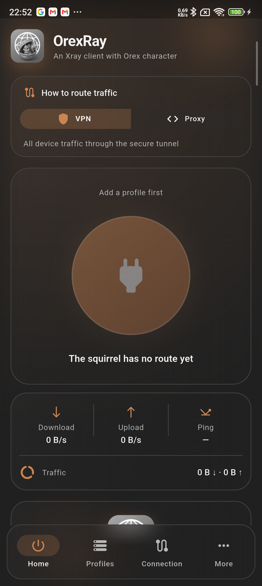
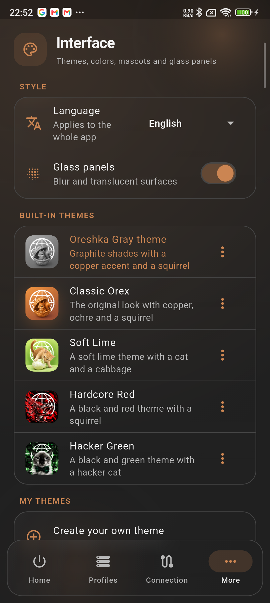

# OrexRay

A friendly **Xray client** for **Android** and **Windows**, built with Flutter.
System VPN, system proxy, local SOCKS5/HTTP proxies, VLESS / VMess / Trojan /
Shadowsocks / SOCKS / HTTP profiles, balancers and per-app routing — in one
warm, glassy interface with a squirrel.

**[Русская версия](README.ru.md)** · [Changelog](CHANGELOG.md)

<p>
  
  
  
</p>

## Why OrexRay

- **One-tap VPN** — Android `VpnService` with real TCP/UDP through Xray,
  running in the background as a foreground service, with a Quick Settings
  tile that works even when the app is closed.
- **Every connection mode** — full TUN VPN, Windows system proxy, and local
  SOCKS5 (`127.0.0.1:20808`) / HTTP (`127.0.0.1:20809`) proxies for manual
  app configuration.
- **Full Xray profiles** — VLESS/REALITY, VMess, Trojan, Shadowsocks, SOCKS
  and HTTP without artificial simplification. Import links, subscriptions,
  QR codes, raw JSON or full configs.
- **Balancers** — pick the lowest-ping server automatically, round-robin, or
  random per connection. Groups of servers stay dynamic.
- **Split tunneling** — choose which apps use the VPN and which bypass it
  (Android).
- **Subscriptions** — HTTP/HTTPS subscription auto-updates, quota and expiry
  tracking, HEAD-based metadata refresh.
- **Themes** — a neutral gray theme out of the box, several built-in presets,
  and a full theme editor: colors, glass panels, mascots, JSON export/import.
- **Two languages** — Russian and English, following the system by default.

## Install

### Android

Download the latest APK from
[GitHub Releases](https://github.com/Vasysik/OrexRay/releases) and install it.
OrexRay can update itself in-app via GitHub Releases.

### Windows

Download the installer from
[GitHub Releases](https://github.com/Vasysik/OrexRay/releases). TUN/VPN mode
requires administrator rights; system proxy and local proxy modes work
without them.

## Quick start

1. Open **Profiles** and import a link (`vless://`, `vmess://`, `trojan://`,
   `ss://`, `socks5://`, `http(s)://`), a subscription URL, a QR code, or Xray
   JSON.
2. Back on **Home**, tap the big round button.
3. Optional: tune routing in **Connection**, split tunneling in **Apps**, and
   themes in **Interface**.

## Documentation

- [Release builds](docs/release-builds.md) · [Android release](docs/release-android.md) · [Windows release](docs/release-windows.md)
- [In-app updates via GitHub Releases](docs/github-app-updates.md)
- [Android debugging / ADB](docs/android-debugging.md)

The full Russian product documentation lives in [README.ru.md](README.ru.md).

## Build from source

```bash
flutter pub get
flutter build apk --release        # Android
flutter build windows --release    # Windows
```

The version is set only in `pubspec.yaml` (`version:` field).

## License

See [LICENSE](LICENSE) and [THIRD_PARTY_NOTICES.md](THIRD_PARTY_NOTICES.md).
